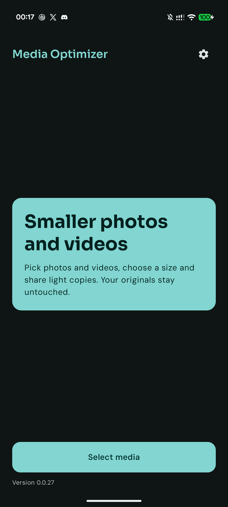
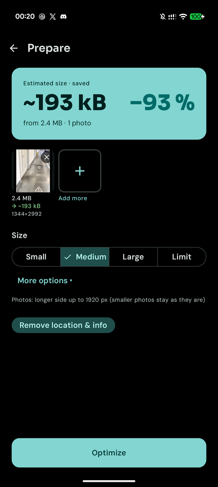
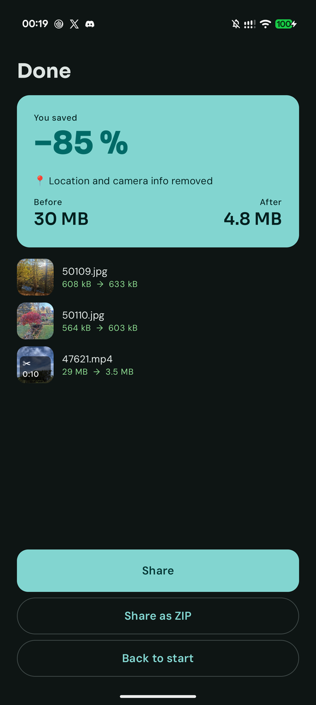
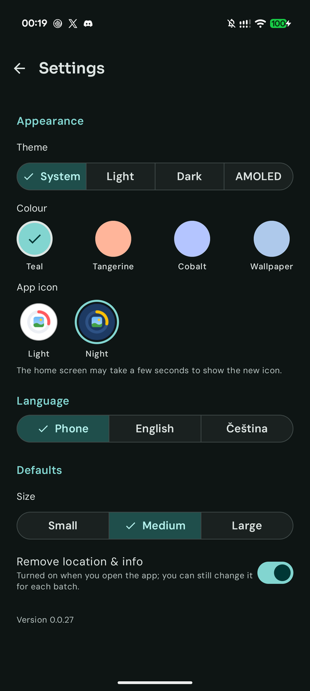
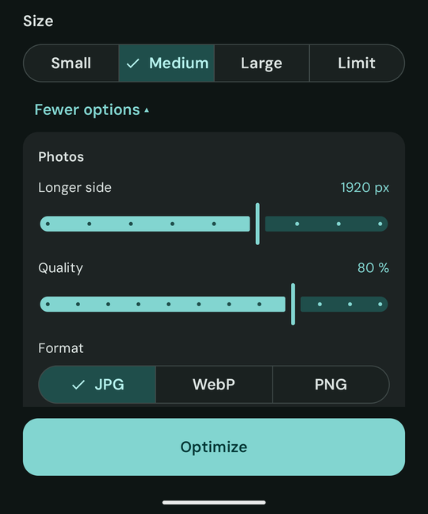
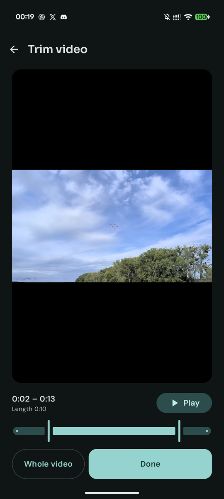

# Media Optimizer

**English** · [Čeština](README.cs.md)

Android app that shrinks photos and videos so you can send them by e-mail, WhatsApp and other messengers. Select files in the gallery, share them to the app, pick a size and share the light copies on. Your originals stay untouched and everything runs offline on the phone.

  
  
  
  

## Features

- **Share in, share out** – share several photos and videos from the gallery to the app, or pick them with the system Photo Picker.
- **Simple presets** – Small / Medium / Large for both photos and videos.
- **Fit into X MB** – set a limit (5, 10, Gmail 18, 25 MB or custom) and the app plans the quality so the whole batch fits.
- **Size estimate** – see the expected size and saving before you start, and the real result after.
- **More options** – longer side, quality and format (JPG / WebP / PNG) for photos; resolution, bitrate and frame rate for videos.
- **Video trimming** – cut the start and end with a live preview, optionally remove audio.
- **Privacy** – location and camera info are removed by default.
- **Share as ZIP** – pack all results into one attachment.
- **Your look** – light, dark, AMOLED or system theme; Teal, Tangerine, Cobalt or wallpaper colours; English or Czech; light or night app icon.

  
  
  

## Install

Every push builds a debug APK with GitHub Actions and publishes it under
[Releases](../../releases/latest). Open that page on the phone, download the
APK and install it. Requires Android 10 or newer.

## Tech

| | |
|---|---|
| Language | Kotlin |
| UI | Jetpack Compose, Material 3 |
| Video | Media3 Transformer |
| Min Android | 10 (API 29) |
| Fonts | Sora and DM Sans (SIL Open Font License), bundled in `app/src/main/res/font` |

Build locally with `./gradlew assembleDebug`, run unit tests with `./gradlew testDebugUnitTest`.

## Docs

- [Product requirements](docs/PRD.md) (Czech)
- [Technical design](docs/TECH_DESIGN.md) (Czech)
